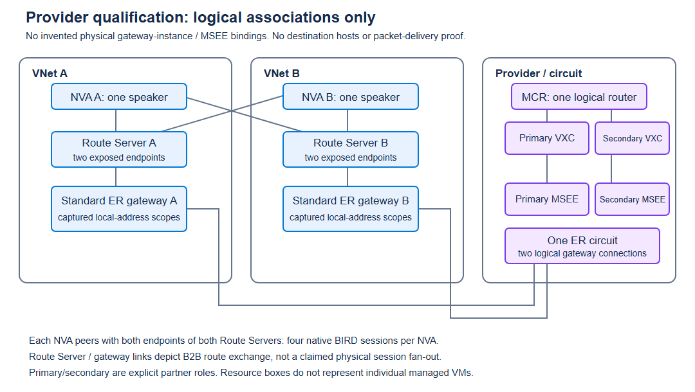

# Native BGP endpoint and route-exchange qualification

Verification for [erjosito/vwan-visual-topology#259](https://github.com/erjosito/vwan-visual-topology/issues/259), performed on 2026-11-21.

**The Azure-only phase and initial ExpressRoute B2B exchange samples passed. Provider withdrawal/restoration remains unqualified.** This is a derived, non-importable report, not a native capture or complete managed-instance inventory. Original identifiers, addresses, captures, credentials and private topology remain private.

## Topology and setup


Four IPv4 VNets in Sweden Central hosted two Azure Route Servers, three Ubuntu B2ts_v2 VMs and two VpnGw1AZ VPN gateways. Two NVAs each established four BIRD endpoint sessions, two to each Route Server. A third VM acted as the site emulator, with StrongSwan and three BIRD VPN endpoint sessions: two to the active-active gateway and one to the isolated active-standby gateway.

The active-active gateway was co-located with Route Server A. Route Server B and the standalone active-standby gateway provided isolation controls. Route Server A's branch-to-branch route exchange was tested off, on and restored off; Route Server B remained off. These are Route Server/hub-and-spoke controls, not a deployed Virtual WAN.

| Resource | Deployed |
|---|---:|
| VNets / Linux VMs | 4 / 3 |
| Route Servers / NVA peering resources | 2 / 4 |
| VPN gateways / S2S connections | 2 / 2 |
| ExpressRoute gateways, circuits, MCRs and VXCs | 0 |

New non-AZ VPN gateway creation was rejected by Azure. The smallest supported VpnGw1AZ replacement was used within the approved estimate. A matching AES256/SHA256/DH14 IKE policy was applied to the exclusively owned S2S connections after the initial default-policy negotiation failed; existing private keys were retained, not retrieved or rotated.

## Results

| Check | Observed result |
|---|---|
| Native Route Server configuration | Two returned endpoint addresses per Route Server; no physical identity mapping assigned |
| Native VPN configuration | Two explicit active-active IP-configuration associations; one active exposed standalone standby association |
| Single-endpoint export suppression | Target export count 2 -> 0 -> 2 while its sampled BIRD session remained Established |
| Non-target export controls | Two exports per sampled endpoint session; eight NVA sessions Established at each sampled phase |
| VPN underlay | Three site BGP sessions, three established IKE SAs and three installed ESP children at each off/on/restored sample |
| Native gateway site observations | Two active-active site rows and one standalone standby site row, native state `Connected`, two received site prefixes each |
| Captured self rows | Active-active native `Unknown` self rows preserved; no standby self row manufactured |
| Private app replay | Assigned addresses, native states, connection durations and message/prefix counters preserved exactly |

### Reciprocal route exchange


| View | B2B off | B2B on | Restored off |
|---|---|---|---|
| Site retained import tables, both active-active peers | NVA-unique routes absent | Both NVA-unique routes present per peer | Absent |
| Both NVAs' retained imports, both Route Server A peers | Site-unique route absent | Site-unique route present per peer | Absent |
| Native Route Server A advertisements to both NVAs, both returned buckets | Site-unique route absent | Site-unique route present | Absent |
| Standalone standby site import control | NVA-unique routes absent | Absent | Absent |
| Both NVAs' Route Server B import control | Site-unique route absent | Absent | Absent |

All retained export tables continued to contain their two intended origin routes. Native Route Server learned rows retained the original source peer and AS path. Some native advertised rows omitted `sourcePeer`; these remain unknown rather than being assigned a guessed source.

Full retained import/export tables, gateway learned/advertised observations and both Route Servers' per-peering learned/advertised observations were collected before grading. Both Route Servers were confirmed B2B-off after restoration.

## Application increment

[erjosito/vwan-visual-topology#378](https://github.com/erjosito/vwan-visual-topology/pull/378) merged the bounded native VPN endpoint inspection increment. It uses explicit native IP-configuration references, not array ordering, to associate assigned addresses. Configuration-only inspection does not invent BGP sessions, physical instances or failover roles.

Validation included focused unit and browser tests, keyboard/axe accessibility checks, production checks at the existing CI two-worker concurrency, offline Electron smoke, private recorded-configuration/session replay and all exact-head PR CI gates. The replay validates recorded present rows, not fresh live sessions or complete inventory coverage. This merge did not release or deploy the application.

The merged follow-up [erjosito/vwan-visual-topology#390](https://github.com/erjosito/vwan-visual-topology/pull/390) adds captured managed-gateway advertised routes. The collector queries each distinct captured remote peer once, excluding native self-address rows. Requested destination peer, native row source peer, forwarding next hop and local endpoint remain separate. Inspection selects one local endpoint; absent endpoint addresses stay explicitly unassigned. Missing peer addresses, denied reads and successful empty results are not conflated. All three exact-head CI jobs passed before merge, and [exact merged-main CI](https://github.com/erjosito/vwan-visual-topology/actions/runs/44925613159) passed for commit `68659774793931651b3ba450ee7c50556dda194c`. No release or application deployment was performed.

Its private off/on replay covered 16 native advertisement commands across both ER gateways. Focused validation covered 28 contract/import tests, collector positive/empty/denied/unknown-address cases, ten browser cases including Japanese keyboard/axe checks, and offline Electron three-mode smoke. Advertisements are observed output, not evidence of remote acceptance, installation or destination delivery.

## ExpressRoute/provider follow-up



A separate, exclusively task-created environment used two peered IPv4 VNets, two Route Servers, two Ubuntu B2ts_v2 NVAs, two Standard ER gateways, one Standard/MeteredData 50-Mbps circuit, one MCR and exactly two 50-Mbps VXCs. Provider products used PAYG / No Minimum Term with renewal disabled. This remains a hub-and-spoke/Route Server test, not a deployed Virtual WAN or a combined simultaneous ER+VPN lab.

| Sample/control | Result |
|---|---|
| Initial provider origin pointing at its BGP peer | Primary advertisement did not satisfy the baseline; failed evidence retained |
| Corrected synthetic origin, distinct non-BGP next hop per provider interface | Both MSEE paths contained the origin; corrected B2B-off passed 32 checks |
| First B2B-on sample, both Route Servers enabled | 24 Azure commands succeeded; 30 original checks passed; eight NVA sessions Established |
| Direct-provider readiness replay | Both initial off/on samples had positive received-prefix counters and the origin directly from each explicit provider next hop; 24 positive/negative regression checks passed |
| VXC administrative control | Initial operation failed before successful native confirmation; no VXC outage qualified |
| Later B2B-on baseline | Primary provider neighbor was native `Connect`, with no direct synthetic origin; controls did not proceed from this failed baseline |
| Explicit VXC/BGP enable and per-interface BGP control attempts | Provider HTTP 400: `Service must be in either active or deployment state to update` |
| Final B2B-off sample | Both Route Servers restored off; all 24 native commands succeeded and eight NVA sessions Established; secondary healthy, primary still `Connect` without the origin |

The provider configuration readback was `LIVE`, enabled and unlocked, with both VXC and BGP shutdown flags false and canonical product identifiers matching the task receipts. Those flags did **not** establish a healthy primary BGP session. The cause of the later primary drift and the provider update rejection was not established; neither is attributed to the failed control without evidence. No successful primary/secondary withdrawal-and-restoration sequence is reported.

The initial on sample showed reciprocal NVA/provider exchange at both MSEEs, both gateways, both Route Servers' per-NVA advertised buckets and all eight retained NVA import tables. The off sample suppressed NVA/provider exchange while retaining provider routes at the gateways and eight established NVA sessions. Synthetic destinations had no hosts; these are control-plane observations, not FIB or packet-delivery qualification.

### Observed adjacency boundary

| Selected local perspective | Source-backed remote observations | Boundary |
|---|---|---|
| Each NVA's single BIRD speaker | Both exposed endpoints of each Route Server: four distinct sessions | Native per-peer import/export tables retained |
| Each Route Server's returned per-NVA route bucket | Both NVAs, with original source peer and role-bucket association retained | Returned role ordering is not physical instance identity |
| Each ER gateway's selected captured local address | Each sample returned one local-address bucket with four native `Connected` neighbor rows | One exposed bucket does not establish complete physical gateway-instance inventory |
| Each MSEE's explicit primary/secondary perspective | One external provider neighbor and four gateway-facing endpoint rows | Gateway-facing addresses are not aliased to gateway local addresses by ordering |
| MCR-facing VXC configuration | One native BGP connection per VXC, with explicit primary/secondary partner role | Numeric provider `bgp_status` values have no inferred FSM meaning |

The logical diagram deliberately omits invented gateway-instance-to-MSEE edge bindings. An established neighbor with numeric zero received prefixes is not treated as a down session. Native non-established FSM strings such as `Connect` remain distinct.

Provider control schemas were checked against official [VXC update source](https://github.com/megaport/megaportgo/blob/838fd3c1aeb15fc1c956c9d32fe70a21f7d67f40/vxc.go) and [BGP/interface types](https://github.com/megaport/megaportgo/blob/838fd3c1aeb15fc1c956c9d32fe70a21f7d67f40/vxc_types.go). Documented schema support is not evidence that an attempted live update succeeded.

## Collection/reproduction guidance

Use only a fresh, explicitly approved and exclusively owned lab. Select VM size/region through catalog and live-capacity checks first. Do not execute these examples against shared or production resources. Angle-bracket values below are placeholders, not original lab identifiers.

```text
az network vnet-gateway list-bgp-peer-status -g <lab-rg> -n <vpn-gateway> -o json
az network vnet-gateway list-learned-routes -g <lab-rg> -n <vpn-gateway> -o json
az network vnet-gateway list-advertised-routes -g <lab-rg> -n <vpn-gateway> --peer <site-address> -o json
az network routeserver peering list-learned-routes -g <lab-rg> --routeserver <route-server> -n <peering> -o json
az network routeserver peering list-advertised-routes -g <lab-rg> --routeserver <route-server> -n <peering> -o json
birdc "show protocols all"
birdc "show route import table <peer>.ipv4 all"
birdc "show route export table <peer>.ipv4 all"
swanctl --list-sas
```

Azure CLI gateway operations returned `{"value":[...]}` containers. Canonical app peer observations require the contained arrays. Preserve native `Connected`/`Unknown` states, counters and explicit endpoint references. Do not derive a BGP self peer from a learned route's `sourcePeer`.

Use ownership preflights and `finally` restoration for reversible controls. Complete bounded compressed guest frames were used to avoid Run Command tail truncation. A transient Entra refresh failure in the CLI guest transport was recovered using direct ARM Run Command for the exact owned VMs, without changing the routing test.

## Limits and cleanup

Snapshots establish sampled state, not continuous availability, traffic delivery, elapsed convergence, failover or physical managed-VM identities. One non-target NVA's raw sampled session timestamps differed backward by 1 ms; this is not evidence of session flaps. No physical identity was inferred from native role-bucket names or returned ordering.

Initial ExpressRoute route exchange is sampled and source-backed; provider redundancy, withdrawal/restoration, complete physical bindings and packet delivery remain unqualified. No provider product was purchased in the earlier Azure-only phase; the separate provider phase purchased only the approved PAYG scope. The epic remains open for its broader inspection/identity work and unresolved qualification boundaries.

Cleanup completed and was verified on 2026-11-21: the exact task resource group, both temporary secret-scoped grants and the task vault attachment are absent. The shared vault remains intact with public network access disabled; unrelated attachments were preserved. The strict preview covered 40 exact lab resources, including six automatically added Defender/subnet NSG auxiliaries separately qualified through task parents and native in-run evidence. The final outcome is recorded in `raw-output/qualification-summary.json`.

The separate provider cleanup preview verified 28 Azure resources, including two Defender children of exact task-created VMs, three task grants, one task vault attachment and the three owned provider products. Both ER connections and the private peering are verified absent. The secondary VXC is verified `DECOMMISSIONED`.

**Provider cleanup is blocked, not complete.** The primary VXC rejects immediate cancellation with HTTP 409, `is not provisioned correctly`, on both the current SDK endpoint and the lab client's endpoint. A retry after secondary decommission still failed. The Azure circuit is `Succeeded`/`Provisioned` with no peerings; neither a stale Azure peering nor complete cleanup is asserted.

The official [service-status documentation](https://docs.megaport.com/api/monitoring) also supports terminating VXCs through their attached MCR. After direct child cancellation failed, a narrowly scoped parent cancellation was attempted as an alternative to the normal child-first ordering. Fresh native guards verified the exact parent, every associated child against the two task receipts, the remaining child's parent binding and PAYG/no-renewal settings. Three offline guard tests passed, including rejection of foreign children and foreign parent bindings. The parent cancellation also returned HTTP 409, `is not provisioned correctly`. No undocumented force operation or new purchase was attempted. Provider-side investigation/intervention is required; both supported cancellation paths were rejected.

At the initial provider-cleanup blocker, the primary VXC, MCR and 26 task Azure resources were retained with narrowly scoped credential access. Subsequent explicit approval allowed independent deletion of unused Azure resources while provider support handles the Megaport products.

**Independent Azure cleanup is verified:** 25 of the 26 remaining Azure resources are removed, including both ER gateways, both Route Servers, both VMs, their disks/NICs/public IPs, both VNets, NSGs and the task private endpoint. All three task grants and the exact task vault attachment are absent. The shared vault remains intact with public network access disabled; unrelated attachments were preserved. One VNet deletion reached native `Failed` with a remaining task-to-task peering. The owned peering was removed and that failed deletion retried successfully; active deletion requests were not duplicated.

Only the ExpressRoute circuit and its resource-group container remain in Azure. The circuit still reports provider state `Provisioned`, so [Azure requires provider deprovisioning to `NotProvisioned` before circuit deletion](https://learn.microsoft.com/azure/expressroute/howto-circuit-cli#deprovisioning-an-expressroute-circuit). Circuit billing continues until provider deprovisioning and circuit deletion complete. No provider-state override or unsupported forced deletion was attempted. The removed VMs/private endpoint are no longer available for provider API retries; remaining provider identities and diagnostic evidence are retained privately for support.

`CANCELLED` and `CANCELLED_PARENT` mean termination requested, not completed; only native `DECOMMISSIONED` or verified absence counts as provider termination. No pre-existing/shared resource was a cleanup target. The independent Azure outcome, residual circuit blocker and timestamped last provider readback are recorded in `raw-output/provider-qualification-summary.json`; neither the earlier Azure-only lab cleanup nor this resource reduction claims complete provider cleanup.

Diagram labels are logical resource aliases, not physical identities. PNG, SVG, draw.io and Excalidraw sources are retained. The Azure gateway pictogram comes from the public diagrams.net Azure icon library and is fitted into a uniform 64-pixel footprint without altering its aspect ratio.
