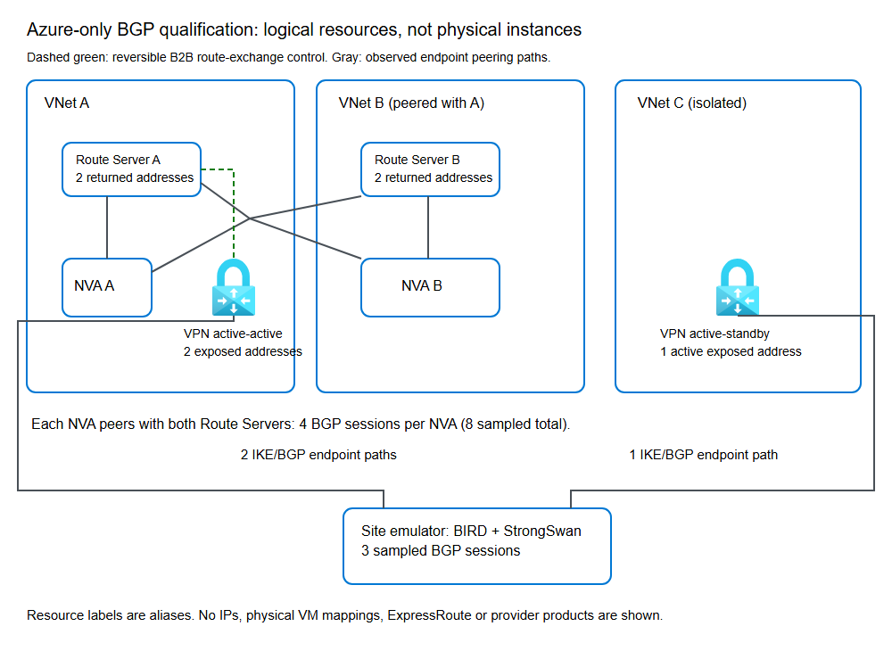
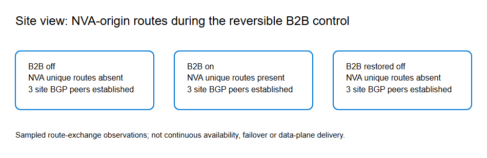

# Azure-only BGP endpoint and route-exchange qualification

Verification for [erjosito/vwan-visual-topology#259](https://github.com/erjosito/vwan-visual-topology/issues/259), performed on 2026-11-21.

**The Azure-only phase passed. The ExpressRoute/provider and failover phase remains unqualified.** This is a derived, non-importable report, not a native capture or complete managed-instance inventory. Original identifiers, addresses, captures, credentials and private topology remain private.

## Topology and setup



Four IPv4 VNets in Sweden Central hosted two Azure Route Servers, three Ubuntu B2ts_v2 VMs and two VpnGw1AZ VPN gateways. Two NVAs each established four BIRD endpoint sessions, two to each Route Server. A third VM acted as the site emulator, with StrongSwan and three BIRD VPN endpoint sessions: two to the active-active gateway and one to the isolated active-standby gateway.

The active-active gateway was co-located with Route Server A. Route Server B and the standalone active-standby gateway provided isolation controls. Route Server A's branch-to-branch route exchange was tested off, on and restored off; Route Server B remained off. These are Route Server/hub-and-spoke controls, not a deployed Virtual WAN.

| Resource | Deployed |
|---|---:|
| VNets / Linux VMs | 4 / 3 |
| Route Servers / NVA peering resources | 2 / 4 |
| VPN gateways / S2S connections | 2 / 2 |
| ExpressRoute gateways, circuits, MCRs and VXCs | 0 |

New non-AZ VPN gateway creation was rejected by Azure. The smallest supported VpnGw1AZ replacement was used within the approved estimate. A matching AES256/SHA256/DH14 IKE policy was applied to the exclusively owned S2S connections after the initial default-policy negotiation failed; existing private keys were retained, not retrieved or rotated.

## Results

| Check | Observed result |
|---|---|
| Native Route Server configuration | Two returned endpoint addresses per Route Server; no physical identity mapping assigned |
| Native VPN configuration | Two explicit active-active IP-configuration associations; one active exposed standalone standby association |
| Single-endpoint export suppression | Target export count 2 -> 0 -> 2 while its sampled BIRD session remained Established |
| Non-target export controls | Two exports per sampled endpoint session; eight NVA sessions Established at each sampled phase |
| VPN underlay | Three site BGP sessions, three established IKE SAs and three installed ESP children at each off/on/restored sample |
| Native gateway site observations | Two active-active site rows and one standalone standby site row, native state `Connected`, two received site prefixes each |
| Captured self rows | Active-active native `Unknown` self rows preserved; no standby self row manufactured |
| Private app replay | Assigned addresses, native states, connection durations and message/prefix counters preserved exactly |

### Reciprocal route exchange



| View | B2B off | B2B on | Restored off |
|---|---|---|---|
| Site retained import tables, both active-active peers | NVA-unique routes absent | Both NVA-unique routes present per peer | Absent |
| Both NVAs' retained imports, both Route Server A peers | Site-unique route absent | Site-unique route present per peer | Absent |
| Native Route Server A advertisements to both NVAs, both returned buckets | Site-unique route absent | Site-unique route present | Absent |
| Standalone standby site import control | NVA-unique routes absent | Absent | Absent |
| Both NVAs' Route Server B import control | Site-unique route absent | Absent | Absent |

All retained export tables continued to contain their two intended origin routes. Native Route Server learned rows retained the original source peer and AS path. Some native advertised rows omitted `sourcePeer`; these remain unknown rather than being assigned a guessed source.

Full retained import/export tables, gateway learned/advertised observations and both Route Servers' per-peering learned/advertised observations were collected before grading. Both Route Servers were confirmed B2B-off after restoration.

## Application increment

[erjosito/vwan-visual-topology#378](https://github.com/erjosito/vwan-visual-topology/pull/378) merged the bounded native VPN endpoint inspection increment. It uses explicit native IP-configuration references, not array ordering, to associate assigned addresses. Configuration-only inspection does not invent BGP sessions, physical instances or failover roles.

Validation included focused unit and browser tests, keyboard/axe accessibility checks, production checks at the existing CI two-worker concurrency, offline Electron smoke, private recorded-configuration/session replay and all exact-head PR CI gates. The replay validates recorded present rows, not fresh live sessions or complete inventory coverage. This merge did not release or deploy the application.

## Collection/reproduction guidance

Use only a fresh, explicitly approved and exclusively owned lab. Select VM size/region through catalog and live-capacity checks first. Do not execute these examples against shared or production resources. Angle-bracket values below are placeholders, not original lab identifiers.

```text
az network vnet-gateway list-bgp-peer-status -g <lab-rg> -n <vpn-gateway> -o json
az network vnet-gateway list-learned-routes -g <lab-rg> -n <vpn-gateway> -o json
az network vnet-gateway list-advertised-routes -g <lab-rg> -n <vpn-gateway> --peer <site-address> -o json
az network routeserver peering list-learned-routes -g <lab-rg> --routeserver <route-server> -n <peering> -o json
az network routeserver peering list-advertised-routes -g <lab-rg> --routeserver <route-server> -n <peering> -o json
birdc "show protocols all"
birdc "show route import table <peer>.ipv4 all"
birdc "show route export table <peer>.ipv4 all"
swanctl --list-sas
```

Azure CLI gateway operations returned `{"value":[...]}` containers. Canonical app peer observations require the contained arrays. Preserve native `Connected`/`Unknown` states, counters and explicit endpoint references. Do not derive a BGP self peer from a learned route's `sourcePeer`.

Use ownership preflights and `finally` restoration for reversible controls. Complete bounded compressed guest frames were used to avoid Run Command tail truncation. A transient Entra refresh failure in the CLI guest transport was recovered using direct ARM Run Command for the exact owned VMs, without changing the routing test.

## Limits and cleanup

Snapshots establish sampled state, not continuous availability, traffic delivery, elapsed convergence, failover or physical managed-VM identities. One non-target NVA's raw sampled session timestamps differed backward by 1 ms; this is not evidence of session flaps. No physical identity was inferred from native role-bucket names or returned ordering.

ExpressRoute/MSEE/provider redundancy and failover remain unqualified. The next provider phase is approved, restricted to PAYG / No Minimum Term with auto-renewal disabled and live pricing/contract verification before ordering. No provider product was purchased in this Azure-only phase. The epic remains open.

Cleanup completed and was verified on 2026-11-21: the exact task resource group, both temporary secret-scoped grants and the task vault attachment are absent. The shared vault remains intact with public network access disabled; unrelated attachments were preserved. The strict preview covered 40 exact lab resources, including six automatically added Defender/subnet NSG auxiliaries separately qualified through task parents and native in-run evidence. The final outcome is recorded in `raw-output/qualification-summary.json`.

Diagram labels are logical resource aliases, not physical identities. PNG, SVG, draw.io and Excalidraw sources are retained. The Azure gateway pictogram comes from the public diagrams.net Azure icon library and is fitted into a uniform 64-pixel footprint without altering its aspect ratio.
